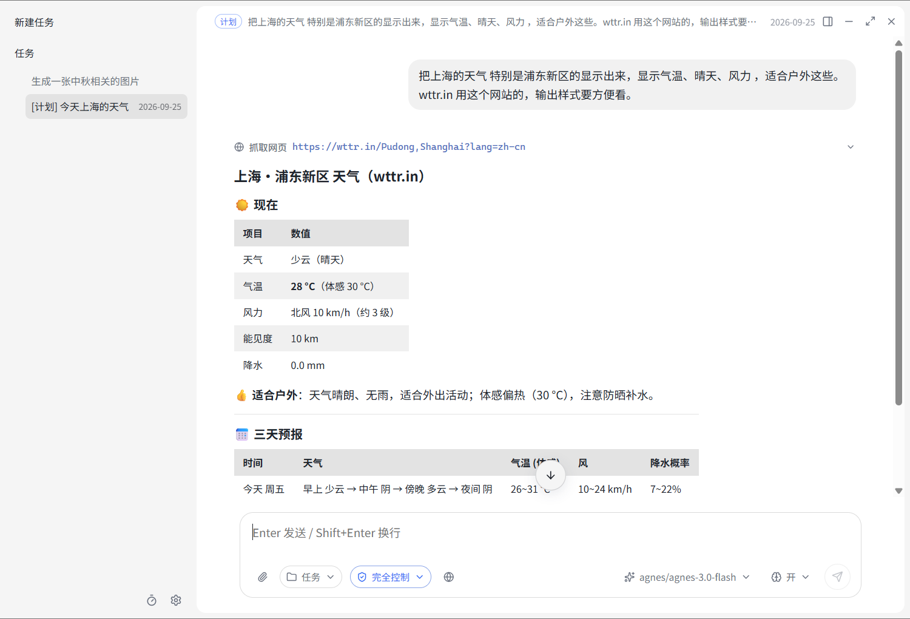
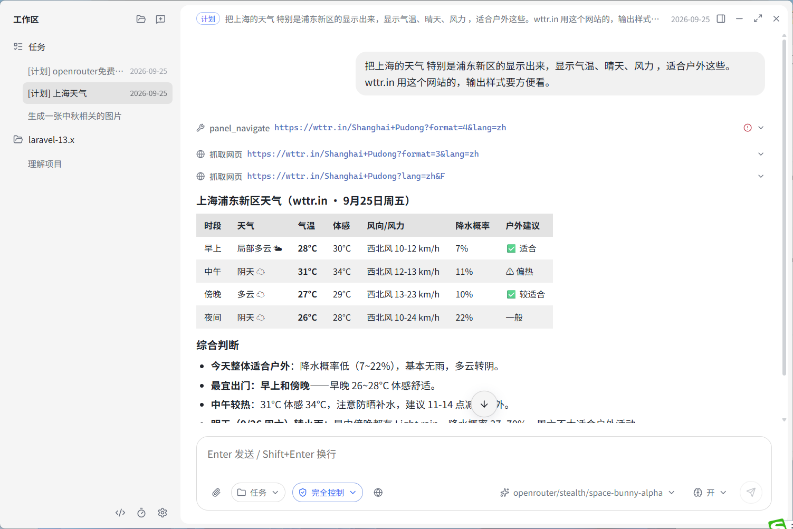
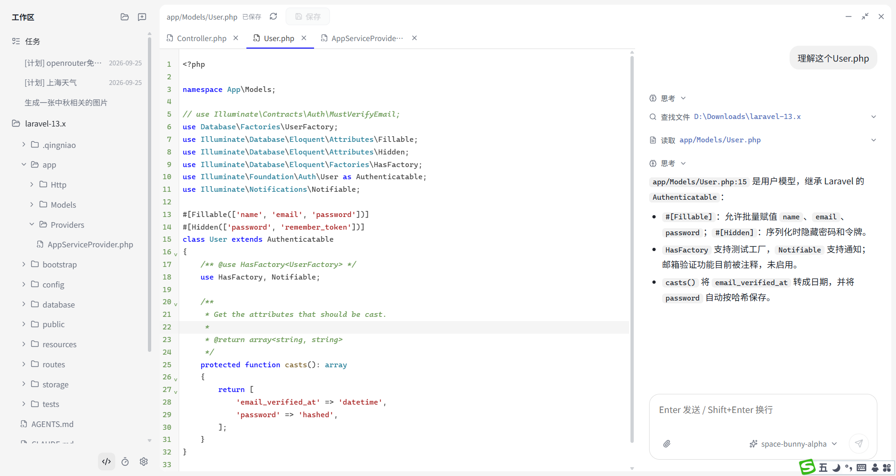
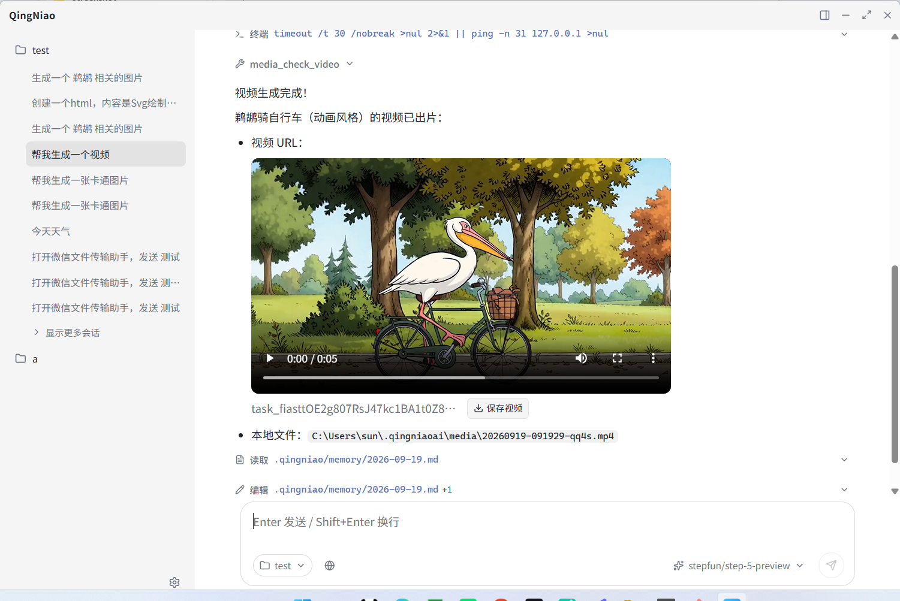

# 青鸟 QingNiao — 开源工作助手

[](./LICENSE)
[](https://github.com/seeuseless/opencode_desk)

**代码地址：<https://github.com/seeuseless/opencode_desk>**



## 界面速览

| 生图：对话内直接嵌出生成结果 | 主动提问：动手前先弹卡片确认需求 | 生视频：轮询期间逐条播报进度 |
| --- | --- | --- |
|  |  |  |

取意神话中替人出行、把事办成带回消息的信使鸟，对标腾讯 WorkBuddy 形态的桌面 AI 工作助手，全开源技术栈：

- **Agent 内核：[OpenCode](https://github.com/sst/opencode)**
  主进程拉起 `opencode serve`（REST + SSE）作为内核，**原生 token 级流式**（message.part.delta），
  工具执行、任务清单（todo）、会话持久化均由内核负责；终端形态 `opencode` 同生态
- **桌面壳：Electron + React + TypeScript**
  主进程适配器透传 OpenCode 原生 API（session/message/part/event），渲染层零协议翻译；
  配置经 `opencode.json` 生成，数据目录经 XDG 环境变量隔离在 `~/.qingniaoai`

## 运行

```bash
git clone https://github.com/seeuseless/opencode_desk.git
cd opencode_desk
npm install        # 首次会下载 Electron 与 OpenCode 原生二进制
npm run dev        # 开发模式（桌面窗口）
npm run build      # 编译 main/preload/renderer
npm run typecheck  # 类型检查
npm run dist       # electron-builder 打 Windows 安装包
npm run dist:mac   # electron-builder 打 macOS dmg/zip（需 .icns，npm install 自动生成）
```

> **macOS 支持**
> - 内核二进制：`opencode-ai` 通过 npm optional 依赖自动拉取对应架构（`opencode-darwin-arm64` / `opencode-darwin-x64`），`npm install` 后无需额外下载。
> - 可执行位：`postinstall` 自动 `chmod +x node_modules/opencode-ai/bin/*`（mac 上 npm 装的二进制常缺 x）。
> - 图标：`postinstall` 用 `sips` + `iconutil` 从 `resources/icon.png` 生成 `resources/icon.icns`。
> - 签名：有 Apple Developer 账号直接 `npm run dist:mac`；个人自用/无账号用 `npm run dist:mac:unsigned` 跳过签名（Gatekeeper 会拦截，需右键打开）。

## 功能

1. 项目树：添加本地文件夹为项目、独立展开/收起、按最近活动排序、会话（任务）删除
2. 草稿会话：新任务不发首条消息不占列表；标题 = 首条消息
3. 模型提供商：自定义 OpenAI **Chat Completions 兼容**端点（Base URL + Key，自动拉取模型列表，可启停），聊天内随时切换并跨重启持久
4. 任务清单：AI 开发任务实时展示（todo.updated 驱动），完成项打勾 + 中划线，进行项转圈
5. 内置浏览器与桌面控制：一键开启 Playwright MCP（AI 可直接操作网页）与 computer-use-mcp（AI 可截屏并操控键鼠，需模型支持图片输入）；同时支持添加自定义 MCP（本地命令 / 远程 URL）
6. 任务队列：执行中继续发任务自动排队，支持插队执行（中断当前）、编辑、删除
7. 步骤可视化：中文工具名、写入实时预览动画、diff/语法高亮展开详情、Markdown 渲染
8. 可靠性：SSE 断线自动重连；错误人性化提示（网关错误、鉴权失败等翻译成中文）
9. 主题：简约浅（默认）+ 深色 + 4 套彩色浅色（晴空蓝/奶油暖米/薄荷青绿/淡粉蔷薇），强调色自动派生气泡/边框/路径文字色
10. 自绘标题栏与全部控件（无原生菜单/下拉/弹窗），图标库 lucide，无手写 SVG
11. 项目记忆：记忆随项目走，存于项目目录 `.qingniao/memory/`（`MEMORY.md` 长期约定 + `YYYY-MM-DD.md` 每日流水）；新对话自动注入历史上下文（注入内容不回显在聊天里），每轮结束后自动追加「用户提问 + AI 结论」要点
12. 技能（Skills）：设置页可视化管理 `SKILL.md`，按**全局 / 项目**两组展示，支持新建、编辑、改名、删除与打开目录，保存前按内核规则校验 frontmatter（名称规范、描述必填、描述长度）；模型平时只看到「名称 + 描述」，判断需要才读全文，不占常驻上下文

## 配置与数据（本机，与用户 ~/.config/opencode 隔离）

```
~/.qingniaoai/settings.json      提供商 + MCP 列表（UI 唯一事实源，首次自动从旧 ~/.codexdesk / ~/.qingniao / ~/.justdo 迁移）
~/.qingniaoai/opencode/          XDG_CONFIG_HOME：生成的 opencode.json + 内核数据
~/.qingniaoai/data/              XDG_DATA_HOME：OpenCode 会话存储
~/.qingniaoai/state/             XDG_STATE_HOME
~/qingniaoai-workspace/          默认"工作台"项目目录
```

以上是应用层数据；**项目记忆不在这里**——它写在被添加为项目的那个目录里，跟仓库走：

```
<项目>/.qingniao/memory/MEMORY.md      项目长期记忆（架构约定、技术选型等）
<项目>/.qingniao/memory/YYYY-MM-DD.md  每日工作流水，每轮对话结束自动追加
```

> 新对话首发时读取这两个文件并作为隐藏上下文注入，AI 因此自带项目背景；日常的流水记录由应用自动追加，无需手动维护。

**技能（Skills）** 同样是磁盘上的文件，位置由内核的发现规则决定，只有两处会被青鸟管理：

```
~/.qingniaoai/opencode/skills/<技能名>/SKILL.md    全局技能，所有项目生效
<项目>/.opencode/skills/<技能名>/SKILL.md          项目技能，仅在打开该项目时生效
```

> 一个技能 = 一个以技能名命名的目录 + 一份大写 `SKILL.md`。frontmatter 必须含 `name`（小写字母/数字/单个连字符，须与目录名一致）与 `description`；
> 内核启动时扫描这两处（另行兼容 `~/.claude/skills`、`~/.agents/skills`），把「名称 + 描述」写进 skill 工具说明，模型据此判断何时加载全文。
> 因为只在启动时加载，设置页里增删改技能后会自动重启内核使其生效——与修改 MCP 的机制一致。

> **端点要求**：自定义提供商走 `@ai-sdk/openai-compatible`，需支持 OpenAI **Chat Completions API**（`/chat/completions` + `/models`）。

## 结构

```
electron/main/adapter.ts   内核生命周期：spawn opencode serve、SSE 事件桥、REST 透传
electron/main/config.ts    settings.json ↔ opencode.json 生成、XDG 目录隔离、密钥 env 注入
src/renderer/              React 界面（oc.ts 门面 API、Markdown、步骤动画、任务清单、队列）
scripts/                   gen-icon 图标生成、smoke 内核冒烟
```

## 第三方组件

本项目在运行时依赖以下开源组件，各自的版权与许可按其上游声明生效：

| 组件 | 许可 |
| --- | --- |
| [OpenCode](https://github.com/sst/opencode)（Agent 内核） | MIT |
| [Electron](https://www.electronjs.org)（含 Chromium / Node.js） | MIT |
| [React](https://react.dev) | MIT |
| [Vite](https://vitejs.dev) / electron-vite / electron-builder | MIT |
| [lucide](https://lucide.dev) 图标 | ISC |
| highlight.js / react-markdown / remark-gfm / rehype-highlight | MIT / BSD-3-Clause |

完整依赖清单及许可见 `package.json` 与各项目上游仓库。

> **字体**：本项目**不打包任何字体文件**，界面全部引用系统已装字体，不构成再分发。
>
> - 正文优先 `Noto Sans SC`（思源黑体，SIL OFL 1.1）——中英同源设计，混排字重一致，是长时间阅读的主选；
>   未安装时依次退回 `Segoe UI Variable Text` / `Segoe UI` / `Microsoft YaHei`。
> - 等宽优先 `Sarasa Mono SC`（更纱黑体，SIL OFL 1.1，中文宽度恰为英文 2 倍，中英混排对齐）；
>   未安装时退回 `Cascadia Mono`（SIL OFL 1.1）/ `Consolas`。
>
> 落到系统字体引用而非内置，是因为微软雅黑、等线、Segoe UI 等均为微软专有授权，只能随系统引用、不可再分发。

## 许可

[MIT License](./LICENSE) — 版权 © 2026 SeeUseLESS。

简言之：你可以自由使用、复制、修改、合并、发布、分发、再授权及销售本软件及其副本，
只需在副本或软件的重要部分中保留原始版权声明与本许可声明。软件按"原样"提供，不作任何保证。
